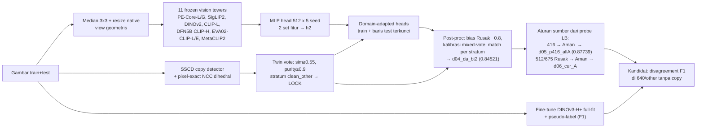

# Datascape 2026: Klasifikasi Kondisi Paket (Aman / Rusak / Lainnya)

Kode, artefak kecil, notebook reproducible, dan catatan eksperimen untuk kompetisi Kaggle `datascape-2026-data-mining-competition`.

- **Metrik:** macro-F1. Public LB memakai 30% data test, private LB 70%.
- **Deadline:** submission 2026-10-10 16:59 UTC; notebook dan write-up 11–15 Oktober.

> **Status per 2026-10-05**
> - **Best public LB tim: 0.87739** (`d05_p416_allA`). Sebelumnya 0.84521 (`d04_da_bt2`). Leaderboard #1 0.97577.
> - **Menunggu skor:** `d06_cur_A`, auto-submit 10-06 00:07 UTC, expected ≈ 0.883.
> - **Lanjutkan dari:** [`FUTURE_WORK.md`](FUTURE_WORK.md) (rencana, kandidat siap pakai, dan apa yang jangan diulang). Log kronologis lengkap ada di [`docs/RESULTS.md`](docs/RESULTS.md).

## 0. Quick start: buat ulang submission 0.87739 dalam satu perintah

```bash
pip install -r requirements.txt
python reproduce_best.py
```

Script ini memakai artefak di repo dan selesai dalam beberapa detik di CPU. Ia menulis `out/submission_d05_p416_allA.csv`, file dengan LB 0.87739, dan meng-**assert bahwa isinya identik baris per baris** dengan yang disubmit (md5 `7b4d91044c`).
- `out/submission_d04_da_bt2.csv` (0.84521) juga dibangun dan diverifikasi.
- Begitu pula `out/submission_d06_cur_A.csv` (pending).
- Datanya ada di repo: `datascape/sample_submission.csv` dan semua artefak di `work/`.

**Notebook lengkap (untuk finalis):** [`notebook/Datascape_Final_Pipeline.ipynb`](notebook/Datascape_Final_Pipeline.ipynb). Generatornya `work/make_final_nb.py`, sudah dieksekusi dengan output tersimpan. Isinya mencakup EDA, data cleaning, data processing, augmentasi, pseudo-label, modeling, ensemble/TTA, post-processing, re-modeling (fine-tune DINOv3-H+), analisis kesalahan, log iterasi, dan 2 submission final. Ada dua mode:
- **QUICK** (default, ±1 menit, tanpa GPU): mereproduksi 4 submission dan meng-assert kesamaannya.
- **FULL** (`DS_FULL=1`, Colab A100 ±3 jam): menghitung ulang embedding 11 tower, pixel copy, heads, dan fine-tune H+ dari gambar.

Cara menjalankannya di Colab: lihat [§3](#3-cara-reproduce).

---

## 1. Struktur repo

```
README.md, FUTURE_WORK.md            ← mulai dari sini
reproduce_best.py                    ← 1 perintah → submission 0.87739 (+ verifikasi md5)
notebook/Datascape_Final_Pipeline.ipynb   ← notebook finalis (QUICK sudah dieksekusi; FULL via DS_FULL=1)
notebook/Datascape_Pipeline.ipynb    ← notebook v1 (10-04), masih valid untuk d04/d05
notebook/output/                     ← CSV yang dibangkitkan notebook (identik dengan yang disubmit)
work/make_final_nb.py                ← generator notebook finalis
work/*.py                            ← script pipeline (tabel di §3)
work/emb/meta_sorted.csv             ← urutan baris global; SEMUA artefak mengikuti urutan ini
work/{folds_group90,meta_noise}.csv, work/{nntr_sscd,pix_all}.npz   ← folds, noise strata, tetangga SSCD, skor pixel-copy (urutan meta_sorted!)
work/preds/{h2_peg_c11,da_h2}/       ← prediksi head: OOF group-fold + test
kernels/ft__ft.py                    ← script fine-tune (DINOv3-H+, LLRD, EMA, cosine, d8 TTA, pseudo-label, full-fit)
colab/make_nb1{0,1,2}.py, run1{0,1,2}.py, run_final.py   ← sesi Colab A100 10–12 + runner notebook finalis
submissions/                         ← semua CSV yang disubmit + ledger.csv (strategi, expected, actual LB)
docs/                                ← RESULTS.md (log), discoveries.md, closed_ideas.md, program.md (NEXT ACTION)
report/                              ← REPORT.md + dashboard HTML (per 10-04)
```

**Tidak disertakan:**
- Gambar kompetisi (aturan data).
- Embedding tower (1,1 GB).
- Bobot fine-tune (1,7 GB).

Lokasinya ada di [`FUTURE_WORK.md` §5](FUTURE_WORK.md#5-di-mana-artefak-besar-disimpan).

## 2. Pendekatan



1. **Sumber data dikenali dari ukuran gambar:**
   - 224: semua Aman;
   - 416: render sintetis kotak di conveyor;
   - 512;
   - 675×900: foto paket kurir;
   - 640: foto web kotak rusak;
   - lainnya: web campuran.

   Komposisi kelas per sumber di test sangat berbeda dari train (§5).
2. **Validasi.** Group 5-fold di atas cluster DINOv2 cos ≥ 0.90 (`work/folds_group90.csv`). Random K-fold menipu: OOF 0.897 vs LB 0.786.
3. **Model I.** 11 tower vision **frozen**, tanpa teks dan zero-shot. MLP head 512 × 5 seed, 2 set fitur → `h2` (group-OOF 0.8926).
4. **Pseudo-label.** Twin lock SSCD (1.534 baris test, akurasi LOO di train 0.981) + **domain-adapted heads**, yaitu head yang dilatih ulang dengan baris test terkunci. Hasilnya LB +0.015.
5. **Post-processing.** Bias Rusak −0.8 untuk baris tanpa twin, kalibrasi mixed-vote, prior-match per stratum noise. Hasilnya **`d04_da_bt2` = 0.84521**.
6. **Aturan sumber dari probe LB berpasangan.**
   - Setiap probe hanya mengubah satu sumber: `work/lbdelta.py` membaca berapa fraksi baris yang di-flip benar-benar Rusak.
   - 416 → Aman menghasilkan **0.87739** (+0.032, semua baris yang di-flip memang Aman).
   - 675 tanpa copy → Rusak turun (0.80201), artinya 675 juga Aman.
7. **Re-modeling.**
   - Fine-tune penuh DINOv3-H+ (resep juara pig-posture) memotong separuh "augmentation shortcut" (§5.1).
   - Model final **F1** = H+ full-fit + pseudo-label (twin lock + baris 416/675 yang sudah dikonfirmasi LB).

## 3. Cara reproduce

| Tujuan | Perintah | Waktu |
|---|---|---|
| Submission 0.87739 (+ d04, d06) | `python reproduce_best.py` | detik, CPU |
| Notebook finalis, QUICK | `cd notebook && jupyter nbconvert --to notebook --execute --inplace Datascape_Final_Pipeline.ipynb` | ±1 menit |
| Notebook finalis di Colab (simpan ke Drive) | jalankan `colab/run_final.py` dari notebook runner Colab, lihat di bawah | ±12 menit |
| FULL dari gambar | `DS_FULL=1` + Colab A100; butuh gambar (`datascape-small-512`) | ±3 jam |
| Hanya fine-tune H+ (F1) | `DS_RETRAIN_FT=1` (notebook §9) atau `colab/make_nb12.py` + `colab/run12.py` | ±2 jam A100 |

**Runner Colab** (pola semua sesi 10–12):
1. Notebook `datascape_a100_runner.ipynb` di Drive pemilik, runtime **A100**.
2. Token Kaggle disimpan di Colab Secret `KAGGLE_API_TOKEN`; token tidak pernah diketik ke kode.
3. Satu cell melakukan semua langkah ini:
   - mount Drive;
   - unduh `asuudane/datascape-colab-code` (snapshot repo);
   - ekstrak pack kode (tar.xz base64);
   - jalankan `run*.py`, yang mengeksekusi notebook dengan nbconvert dan mencetak status + ETA tiap menit;
   - salin hasil ke Drive `datascape_2026/<sesi>`;
   - `runtime.unassign()` (GPU langsung dilepas).
4. Generator pack/cell: lihat `colab/make_nb1*.py` dan bagian Colab di `docs/program.md`.

**Script penting** (jalankan dari root repo):

| Script | Fungsi |
|---|---|
| `reproduce_best.py` | submission terbaik + verifikasi |
| `work/make_final_nb.py` | membangun notebook finalis (`--exec` untuk mengeksekusi) |
| `work/make_folds.py` | group folds dari cluster DINOv2 |
| `work/sscd.py`, `work/twin.py nn sscd` | copy detector SSCD + tetangga train (`nntr_sscd.npz`) |
| `work/pixall.py` | skor pixel-exact NCC dihedral (`pix_all.npz`, **urutan meta_sorted**) |
| `work/da_heads.py` | domain-adapted heads |
| `work/pl_iter.py` | pseudo-labeling iteratif + evaluasi test-domain hold-out |
| `work/lbdelta.py BASE PROBE S0` | membaca probe LB: LB probe sebagai fungsi q (fraksi baris yang di-flip yang benar-benar Rusak). Jumlah baris publik di-integrasikan Binomial(n, 0.3); mendukung flip dua arah |
| `work/subreg.py add/submit/sync/show` | ledger submission (expected vs actual). Submit hanya dari akun tim |
| `kernels/ft__ft.py` | fine-tune: `CFG` JSON lewat env; opsi `aug` d8/augeq, `tta`, `pseudo_file`, `full_fit`, LLRD, EMA, cosine |
| `colab/make_nb1{0,1,2}.py` | notebook sesi 10 (copy matching + gate H+), 11 (gate shortcut), 12 (model final F1) |

## 4. Skenario yang sudah dijalankan (ringkas)

Ranking lengkap: [`report/REPORT.md`](report/REPORT.md) (per 10-04) dan [`docs/RESULTS.md`](docs/RESULTS.md) (sampai 10-05).

| Kategori | Skenario | Hasil | Keputusan |
|---|---|---|---|
| Validasi | random KFold vs group90 | random 0.897 OOF → LB 0.786 (menipu) | group90 |
| Frozen towers | ~30 tower diuji, termasuk DINOv3, VLM towers | MLP cat6+PE-G 0.892; tower baru +≤0.002 | cat6+PE-G & cat11 |
| Fine-tune L | CLIP-L, ConvNeXt, EVA02, PE-L, DINOv2-L, SigLIP2 | 0.82–0.88 OOF, di bawah frozen | ditutup |
| **Leakage/duplikat** | SSCD twin lock + DA heads | **LB 0.84521** (+0.015 berpasangan) | dipakai |
| **Probe sumber** | 416 → Aman / 675 tanpa copy → Rusak | **0.87739** / 0.80201 | 416 dan 675 = Aman |
| **Fine-tune H+ (sesi 10–12)** | DINOv3-H+ `d8`, train-only (h3A) | Rusak pada baris Aman terkonfirmasi LB: 0.938 → **0.487** | model F1 |
| | `augeq`: semua gambar selalu dikorupsi | 0.522 | ditutup |
| | F1 = full-fit + pseudo-label | kandidat 6 / 31 flip | lihat FUTURE_WORK |
| Cleaning | relabel Confident Learning / cleanlab | LB −0.019 | ditutup |
| Pseudo-label iteratif | 3 ronde τ 0.9 | +0.0024 hold-out | ditutup |
| Post-proc | Lainnya prior-match 3.5% | baris P(L) 0.06–0.08 hanya 0.3% Lainnya di OOF | parkir |

Compute A100 sesi 10–12 (10-04 s/d 10-05): ±7 jam. Setiap sesi melepas runtime-nya sendiri.

## 5. Temuan kunci

1. **Augmentation shortcut.** Ini sumber error utama.
   - Di train, gambar **Aman** banyak yang sudah di-augmentasi panitia: noise Gaussian/impulse, rotasi dengan sudut hitam/putih, brightness. Contoh share noisy Aman vs Rusak: 416 0.46 vs 0.04, 675 0.57 vs 0.03.
   - Gambar **Rusak** dan **semua gambar test** mentah (test noisy 0–3%, kecuali 224/512).
   - Akibatnya model belajar "mentah = Rusak" dan memprediksi Rusak berlebih di test. Montage 416: test berisi kotak utuh mentah yang oleh model dibilang Rusak, padahal LB membuktikannya Aman.
2. **Fine-tune penuh memotong separuh shortcut; augmentasi saja tidak.**
   - Pada 339 baris yang dikonfirmasi LB sebagai Aman tanpa copy di train, Rusak turun dari h2 0.938 ke h3A **0.487**.
   - Panggilan Rusak di baris copy-Rusak tetap terjaga (0.978).
   - Mengkorupsi semua gambar (`augeq`) tidak membantu (0.522).
3. **Copy.**
   - 26% baris test punya copy pixel-exact di train. Label copy train-train sepakat 96,2%.
   - Label twin SSCD di baris yang diperdebatkan hanya ±55% benar. Di render sintetis 416, kotak penyok dan utuh hampir identik di 128 px.
4. **Ekspektasi dari OOF label train selalu terlalu tinggi.** `d04_da_bt2` diekspektasi 0.93, aktualnya 0.845. Setiap lever harus di-anchor dengan probe LB berpasangan, satu kelompok baris per probe.
5. **Inversi gabungan 3 skor LB** menghasilkan F1 publik per kelas: Aman ±0.89, Rusak ±0.81, Lainnya ±0.85 (interval lebar). Jumlah Lainnya publik ±17, setara dengan prediksi, sehingga Lainnya belum bisa ditindaklanjuti.
6. **Bug yang sudah diperbaiki (10-05).** `pix_all.npz` berurutan `meta_sorted`, **bukan** `meta.csv`. Jangan pernah me-reindex lewat `meta.csv`.

## 6. Riwayat submission tim (pipeline ini)

| Submission | Isi | Public LB |
|---|---|---|
| `r1003_calib_knn_probe` | kNN + LR DINOv2/CLIP | 0.78627 |
| `d04_da_bt2` | twin lock + DA heads + post-proc | 0.84521 |
| `d05_h2_nolock_s337` | tanpa twin lock (probe berpasangan) | 0.83004 |
| **`d05_p416_allA`** | d04 + 416 Rusak → Aman | **0.87739** |
| `d05_p675_R` | d04 + 675 tanpa copy → Rusak | 0.80201 |
| `d06_cur_A` | d05_p416 + 25 Rusak di 512/675 → Aman | pending (exp. ±0.883) |

Detail expected vs actual ada di `submissions/ledger.csv`.

## 7. Aturan kompetisi yang dipatuhi

- Hanya data panitia; tidak ada dataset atau label eksternal.
- Tidak ada inferensi LLM/VLM. Tower vision dipakai sebagai encoder gambar (frozen atau fine-tune) tanpa teks dan tanpa zero-shot.
- Tidak ada prediksi manual. Setiap keputusan adalah aturan programatik per kelompok sumber; montage hanya dipakai untuk analisis.
- Submit hanya dari akun tim `ajikajadeh`. Limit 3/hari dipakai bersama.
- Deklarasi AI: kode dan analisis dibuat dengan bantuan AI coding assistant (Claude, Anthropic). Semua keputusan tercatat di `docs/` dan `submissions/ledger.csv`.
