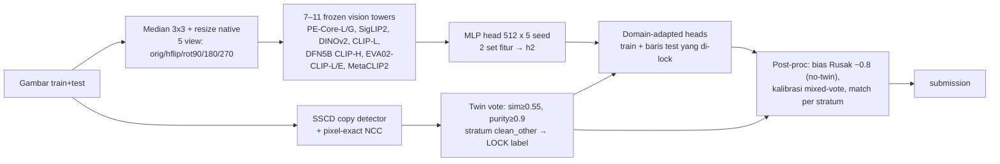

# Datascape 2026: Klasifikasi Kondisi Paket (Aman / Rusak / Lainnya)

Kode, artefak kecil, dan catatan eksperimen untuk kompetisi Kaggle `datascape-2026-data-mining-competition`.

- **Metrik:** macro-F1. Public LB memakai 30% data test, private LB 70%.
- **Deadline:** submission 2026-10-10 16:59 UTC; notebook dan write-up 11–15 Oktober.

> **Status per 2026-10-04 08:00 UTC**
> - **Best public LB tim:** **0.84521** (`d04_da_bt2`). Leaderboard #1 0.97577, #2 0.92362.
> - **Gap CV → LB** ≈ −0.065 pada share Rusak yang sama. Sumbernya konvensi label per sumber data, bukan kapasitas model (lihat [Temuan kunci](#temuan-kunci)).
> - **Laporan lengkap:**
>   - [`report/REPORT.md`](report/REPORT.md): 48 skenario, diranking menurut kekuatan bukti.
>   - [`report/datascape_board.html`](report/datascape_board.html): dashboard; unduh lalu buka di browser.
>   - [`docs/RESULTS.md`](docs/RESULTS.md): log kronologis.

---

## 1. Struktur repo

```
README.md                      ← dokumen ini
notebook/Datascape_Pipeline.ipynb   ← notebook reproducible (sudah dieksekusi, output tersimpan)
notebook/output/               ← 3 CSV yang dibangkitkan notebook (identik dengan yang disubmit)
report/REPORT.md               ← ranking skenario, expected vs actual LB, leakage, compute log
report/datascape_board.html    ← dashboard MLOps (versi HTML dari REPORT.md)
docs/                          ← catatan relay: RESULTS.md (log), discoveries.md (temuan), closed_ideas.md (jangan diulang), program.md (rencana + NEXT ACTION)
work/*.py                      ← semua script pipeline (lihat tabel di §4)
work/emb/meta_sorted.csv       ← urutan baris global (semua artefak mengikuti urutan ini)
work/*.csv|npz|npy             ← artefak kecil: folds, noise strata, tetangga SSCD, skor pixel-copy, label bersih, dll.
work/preds/{h2_peg_c11,da_h2,c2_h2}/  ← prediksi head (OOF group-fold + test) yang dipakai submission terbaik
colab/                         ← driver sesi Colab A100 (embedding giant tower, fine-tune, gate probe)
kernels/                       ← kernel Kaggle, diratakan `<nama>__<file>` (embedding tower, fine-tune, ablation, copy-detector; lihat kernels/README.md)
submissions/                   ← CSV submission + ledger.csv (strategi, expected LB, actual LB)
datascape/sample_submission.csv
```

**Tidak disertakan:**
- Gambar kompetisi (aturan data).
- Embedding tower `work/emb/emb_*.npz` (1,2 GB).
- Bobot model.

Untuk mendapatkannya, lihat [§3](#3-cara-reproduce).

## 2. Pendekatan: pipeline submission terbaik `d04_da_bt2` (LB 0.84521)



1. **Data dan sumber.** Ukuran gambar menandai sumber data:
   - 224×224: semua train Aman;
   - 416×416: render sintetis kotak obat di conveyor;
   - 512×512: kebanyakan Aman;
   - 640×640: foto web/stock kotak rusak;
   - 675×900: foto paket kurir Vietnam (GHTK);
   - lainnya: web campuran.

   Komposisi sumber di train dan test sangat berbeda: 224 hanya 2% train tetapi 17% test, sedangkan 512 adalah 20% train dan hanya 1,5% test.
2. **Validasi.**
   - Random K-fold menipu karena memorisasi near-duplicate: OOF 0.897 vs LB 0.786.
   - Kita memakai **group 5-fold** di atas cluster DINOv2 cos ≥ 0.90 (`work/folds_group90.csv`).
   - Catatan: 6,7% pasangan copy pixel-exact masih menyeberang fold, jadi OOF sedikit optimistis.
3. **Fitur.**
   - Tower vision **frozen**, tanpa teks dan tanpa zero-shot, sesuai aturan. Gambar di-median filter 3×3 karena ada noise salt-and-pepper yang hampir hanya ada di train Aman. Resolusi native, 5 view geometris dijumlah.
   - Set `cat6+PE-G`: PE-Core-L/14@336, SigLIP2-so400m@384, DINOv2-L, CLIP-L, DFN5B CLIP-H, EVA02-CLIP-L, dan PE-Core-G@448.
   - Set `cat11`: ditambah EVA02-E, MetaCLIP2-H/G, dan SigLIP2-g.
4. **Head.**
   - MLP 512: dropout 0.5/0.3, label smoothing 0.1, AdamW + OneCycle, 40 epoch.
   - `h2` = rata-rata geometris dua set fitur × 5 seed. Group-OOF 0.8926 vs label asli.
5. **Leakage dan duplikat.**
   - Copy detector SSCD mencari 10 tetangga train untuk setiap gambar.
   - Verifikasi **pixel-exact**: NCC dihedral (4 rotasi × flip) pada thumbnail grayscale 128 px. Ini lebih ketat dari MD5 karena tahan re-encode, resize, rotasi, dan flip.
   - 26% baris test punya copy persis di train. Copy train-train sepakat label 96,2%.
6. **Twin lock.**
   - Baris test di stratum `clean_other` dikunci ke label vote twin SSCD (sim ≥ 0.55, purity ≥ 0.9). Akurasi leave-one-out di train 0.981.
   - Total 1.534 baris test terkunci.
7. **Domain-adapted heads.** Head dilatih ulang pada train + baris test terkunci, sehingga head "melihat" pergeseran domain test (`work/da_heads.py`).
8. **Post-processing** (`build_da_bt2` di notebook §6):
   - Baris tanpa twin: bias logit Rusak −0.8, dikalibrasi dengan CV pada baris terkunci yang di-hold-out.
   - Baris mixed-vote: share Rusak dikalibrasi dari bin vote di train (0.555).
   - Stratum lain: P(Rusak | stratum) dari train.

## 3. Cara reproduce

**Panduan langkah demi langkah menjalankan notebook submission terbaik ada di [`notebook/README.md`](notebook/README.md).**

```bash
pip install -r requirements.txt
cd notebook && jupyter nbconvert --to notebook --execute --inplace Datascape_Pipeline.ipynb   # < 1 menit
```

**Mode default (`RETRAIN=False`).**
- Memuat prediksi head yang tersimpan, lalu membangun ulang `d04_da_bt2`, `d05_p416_allA`, dan `d05_p675_R`.
- Notebook **assert sama baris per baris** dengan file yang disubmit. Ini bukti reproducibility.

**Mode retrain (`DS_RETRAIN=1`).**
- Melatih ulang domain-adapted heads dari embedding (±10 menit di Apple MPS, ±2 menit di GPU CUDA).
- Butuh `work/emb/emb_*.npz`, yang tersimpan di dataset Kaggle privat `asuudane/datascape-artifacts` dan `asuudane/datascape-colab-out*` (minta akses), atau dihitung ulang:
  - `colab/emb_giant.py`: A100, bf16;
  - `kernels/emb*__emb.py`: Kaggle T4.
- Seed berbeda per device, jadi yang dilaporkan adalah agreement, bukan equality.

**Script penting** (jalankan dari root repo):

| Script | Fungsi |
|---|---|
| `work/make_folds.py` | membuat group folds dari cluster DINOv2 |
| `work/sscd.py`, `work/twin.py nn sscd` | copy detector SSCD + tetangga train (`nntr_sscd.npz`) |
| `work/pixall.py` | skor pixel-exact NCC dihedral (`pix_all.npz`) |
| `work/twin.py build ...` | twin lock + post-processing (`d04_*`) |
| `work/da_heads.py` | domain-adapted heads (opsi `PRUNE=` untuk retrain tanpa baris tertentu) |
| `work/ens.py`, `work/ens2.py` | blending, hill climbing, LR stacking (fold-honest) |
| `work/cleanlab_audit.py`, `work/src640.py` | audit noise label dengan cleanlab (wajib `n_jobs=1` di macOS) |
| `work/pl_iter.py` | pseudo-labeling iteratif dengan evaluasi test-domain hold-out |
| `work/lbdelta.py BASE PROBE S0` | membaca hasil probe LB: berapa fraksi baris yang di-flip benar-benar Rusak |
| `work/subreg.py add/submit/sync/show` | ledger submission (expected vs actual) |
| `work/build_report.py`, `work/make_notebook.py` | membangun laporan dan notebook dari CSV sumber |
| `colab/driver*.py`, `colab/probe8.py`, `kernels/ft__ft.py` | sesi A100: embedding tower, fine-tune (protocol v2: warmup, EMA, ReduceLROnPlateau, early stop) |

## 4. Skenario uji coba yang sudah dijalankan

Ranking lengkap ada di [`report/REPORT.md`](report/REPORT.md). Ringkasan per kategori:

| Kategori | Skenario | Hasil | Keputusan |
|---|---|---|---|
| **Validasi** | random KFold vs group90 | random 0.897 OOF → LB 0.786 (menipu); group90 0.805 paling dekat LB | group90 dipakai |
| **Arsitektur (frozen)** | ~30 tower: PE-Core-L/G, SigLIP2, DINOv2/v3, CLIP-L/H, EVA02-L/E, MetaCLIP2, AIMv2, InternViT, Qwen3-VL ViT, Florence-2, Gemma-ViT | terbaik tunggal PE-Core-G 0.851 (LR probe); MLP cat6+PE-G 0.892 | dipakai cat6+PE-G & cat11 |
| | DINOv3-L / H+ / 7B ditambahkan | +0.001 / +0.0003 / +0.0018 | ditutup (bar +0.005) |
| | VLM towers (bf16 + mean pooling): InternViT-300M, AIMv2-H, Qwen3-VL ViT | −0.0002 / −0.0019 / −0.003 | ditutup |
| **Arsitektur (fine-tune)** | CLIP-L, ConvNeXt-B/L, EVA02-B/L, PE-L, DINOv2-L, SigLIP2@384 | 0.82–0.88, selalu di bawah frozen head | ditutup |
| | head hierarkis 2 tahap | 0.769 vs 0.805 | ditutup |
| | loss robust noise (GCE, SCE, bootstrap) | +0.0015 | noise level |
| **Preprocessing / TTA** | resolusi lebih tinggi dari native | −0.002 s/d −0.008 | native dipakai |
| | multi-resolution view | −0.006 | ditutup |
| | median 3×3, TTA 5 view | desain | dipakai |
| **Ensemble** | blend log-mean / hill climbing / LR stacking | stacking 0.915 OOF tapi share Rusak test naik ke 0.37–0.41 | tidak dipakai |
| **Cleaning label noise** | Confident Learning relabel 700 baris | LB −0.019 | ditutup (relabel merugikan, sejalan dengan solusi juara chaii) |
| | CL 2 ronde + cluster majority (`labels_clean_v2`) | OOF asli 0.8954 | parkir |
| | **cleanlab** 2.9 global + Datalab | 447 flag, 333 sama dengan CL kita | ditutup |
| | cleanlab per sumber (640) + prune + retrain | 0 baris test berubah; baris test 640 memang rusak secara visual | ditutup |
| **Leakage / duplikat** | MD5 identik | 253 baris test | dipakai |
| | SSCD twin lock + purity gate | LOO 0.981 | dipakai |
| | SSCD-large, rotation-robust, SIFT-RANSAC | ≤ +0.0004 | ditutup |
| | pixel-exact NCC dihedral | 796 baris test (26%) | dipakai |
| | urutan ID test | tidak bocor | ditutup |
| | struktur copy per sumber | lihat temuan #3 | sedang diuji |
| **Domain adaptation** | DA heads (train + test terkunci) | LB berpasangan +0.015 (0.845 vs 0.830) | dipakai |
| **Pseudo-labeling** | pseudo-label twin di fine-tune | di bawah frozen head | ditutup |
| | pseudo-label iteratif τ = 0.9, 3 ronde | F1 hold-out +0.0024 | ditutup |
| **Post-processing** | bias kelas fold-honest | +0.042 OOF | dipakai |
| | prior matching per stratum | targetnya dari subset tak representatif | diganti |
| | share dial Rusak | baris yang di-flip terlihat rusak | parkir |
| | koreksi Lainnya | F1 Lainnya 0.955; tak ada Lainnya tersembunyi | ditutup |

Compute A100 yang dipakai: 9 sesi, ±7 jam. Setiap sesi di-release setelah selesai (log di REPORT.md).

## 5. Temuan kunci

1. **Ekspektasi dari validasi berbasis label train selalu terlalu tinggi.** `d04_da_bt2` diekspektasi 0.93, aktualnya 0.845. Setiap lever baru harus di-anchor dengan probe LB berpasangan yang hanya mengubah satu kelompok baris (`work/lbdelta.py`).
2. **Gap −0.065 bukan karena campuran sumber.** OOF yang dibobot ulang ke komposisi sumber test tetap memprediksi 0.90–0.92. Penyebabnya konvensi atau prior label per sumber.
3. **Struktur copy per sumber.** Di sumber sintetis/kurasi (416, 512, 675), **hanya baris Aman yang punya copy di test**: 0 dari 807 baris train Rusak di sumber itu punya copy test. Hipotesis: baris test tanpa copy di sumber tersebut jauh lebih sering Rusak daripada yang diprediksi. Di 675, model memprediksi hanya 11% Rusak.
4. **Frozen tower + MLP > fine-tune**, dan menambah tower baru tidak lagi memberi gain di atas noise.
5. **Twin lock + domain adaptation** adalah satu-satunya lever yang terbukti di LB (+0.015).
6. Baris 640 yang diprediksi Rusak dan baris yang akan di-flip oleh share dial **terlihat rusak secara visual**. Jadi cerita "test memakai definisi Rusak yang lebih ketat" melemah.

## 6. Submission 10-05 00:00 UTC (2 slot) dan aturan keputusan

| Submission | Perubahan vs `d04_da_bt2` | Expected |
|---|---|---|
| `d05_p416_allA` | semua 136 prediksi Rusak di sumber 416×416 → Aman | 0.850 [0.81, 0.88] |
| `d05_p675_R` | 158 baris 675×900 **tanpa copy train** (NCC ≤ 0.8) → Rusak | 0.855 [0.81, 0.88] |

Keduanya menguji hipotesis yang berlawanan, jadi kemungkinan besar salah satunya turun. Ini **probe**, bukan pilihan final. Pilihan final Kaggle tetap bebas; fallback-nya `d04_da_bt2`.

| Hasil | p675_R | p416_allA | Tindakan 10-06 |
|---|---|---|---|
| struktur copy benar | ≥ +0.01 | ≤ −0.01 | Rusak untuk baris tanpa copy di sumber sintetis/kurasi; 416 tetap |
| konvensi test lebih ketat | ≤ −0.01 | ≥ +0.01 | pertahankan lock DA di 675; 416 → Aman |
| prior per sumber beda | naik | naik | terapkan keduanya |
| base sudah benar | turun | turun | pertahankan da_bt2 + koreksi exact-copy saja |

## 7. Future work (prioritas)

1. **Baca hasil probe 10-05** dengan `python work/lbdelta.py submissions/d04_da_bt2.csv submissions/<probe>.csv 0.84521`, lalu bangun kombinasi per sumber untuk 10-06 sesuai tabel di atas.
2. **Koreksi exact-copy:** 20 baris test bertentangan dengan copy pixel-exact-nya (notebook §7). Cek ulang yang di 416 pada resolusi penuh (`work/pix256_416x416.csv`), karena render sintetis bisa mirip di 128 px.
3. **Probe sumber lain.** Sumber "other" (1.672 baris test) diprediksi 24% Rusak vs 15% di train; 512 dan 224 belum diprobe. Satu sumber per probe, selalu dengan `lbdelta`.
4. **Head yang sadar sumber:** fitur sumber atau ukuran gambar, bias atau threshold per sumber yang dikalibrasi dari baris test terkunci.
5. **Fold yang sadar exact-copy:** gabungkan pasangan NCC ≥ 0.99 ke grup yang sama, untuk menutup kebocoran 6,7% dan memperketat CV.
6. **Model "kerusakan visual"** yang dilatih dari sumber berlabel paling bersih, sebagai ranking alternatif untuk baris ambigu.
7. **Deliverable 11–15 Oktober:** ganti nama notebook ke format `NamaTim_Notebook.ipynb`, siapkan write-up PDF dengan deklarasi AI, dan pindahkan artefak embedding ke dataset Kaggle yang bisa diakses juri.

**Jangan diulang tanpa bukti baru:** lihat [`docs/closed_ideas.md`](docs/closed_ideas.md). Isinya antara lain fine-tune tower L, DINOv3, tower VLM, cleanlab global, pseudo-label iteratif, relabel CL, share dial, dan stacking.

## 8. Aturan kompetisi yang dipatuhi

- Hanya data panitia. Tidak ada dataset atau label eksternal.
- Tidak ada inferensi LLM/VLM pada data. Tower vision dipakai sebagai encoder gambar frozen atau di-fine-tune tanpa teks; tidak ada zero-shot CLIP.
- Tidak ada prediksi manual: semua keputusan probe bersifat programatik dan per kelompok sumber.
- Submit hanya dari akun tim `ajikajadeh`.
- Deklarasi AI: kode dan analisis dibuat dengan bantuan AI coding assistant (Claude); semua keputusan dicatat di `docs/` dan `submissions/ledger.csv`.
