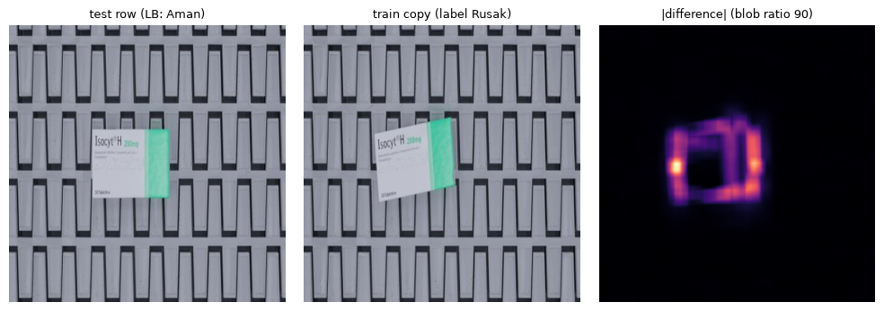

# Write-up DATASCAPE 2026: Klasifikasi Kondisi Paket (Aman / Rusak / Lainnya)

**Tim:** last game · **Metrik:** macro-F1 · **Submisi terbaik:** `d11_lbopt`, public LB **0.88891** · **Private LB:** (diisi setelah pengumuman)

## 1. Ringkasan

Tugasnya mengklasifikasikan foto paket e-commerce menjadi tiga kelas: **Aman**, **Rusak**, dan **Lainnya** (kemasan non-standar).

Temuan inti kami: **label test mengikuti konvensi per sumber data, dan konvensi itu tidak selalu sama dengan label train.** Sumber data bisa dikenali dari ukuran gambarnya.

Contoh paling jelas adalah sumber 416×416 (kotak di konveyor, sintetis):

- 136 baris test adalah salinan piksel dari gambar train berlabel Rusak;
- LB membuktikan baris test tersebut Aman (+0.032 saat diubah);

- analisis piksel menunjukkan latar salinan train itu identik dengan gambar test; yang berbeda **hanya area kotaknya** (kotak di-render ulang dengan posisi/rotasi lain). Jadi label Rusak di sana adalah konvensi pembuat data sintetis, bukan kerusakan yang terlihat (bagian 3.4).

Karena itu kami tidak memakai CV di label train sebagai patokan. Patokannya adalah **probe LB berpasangan** dan **regresi atas semua skor LB**.

## 2. Data dan pemahaman masalah

- **Ukuran data:** 12.224 gambar train (Aman 8.800, Rusak 3.001, Lainnya 423) dan 3.057 gambar test.
- **Sumber data dikenali dari ukuran gambar:**

  | Sumber | Isi | Jumlah test |
  |---|---|---|
  | 224×224 | semua Aman di train | 520 |
  | 640×640 | foto kotak dari web | 347 |
  | 675×900 / 679×900 | foto parsel VN | 280 / 30 |
  | 416×416 | kotak konveyor sintetis | 193 |
  | thumbnail tinggi ±251 px | — | 393 |
  | *long tail* ratusan ukuran lain | — | — |

- **Komposisi train dan test sangat berbeda per sumber.** Contoh: 512×512 ada 2.492 di train tetapi hanya 45 di test; 224×224 ada 253 di train tetapi 520 di test. Artinya prior kelas per sumber di test tidak bisa diambil dari train.
- **Duplikat lintas split.** 1.129 baris test punya salinan piksel di train (NCC dihedral ≥ 0.95), dan 253 di antaranya identik byte.

- **Noise label.** Di dalam train, 169 dari 4.401 pasangan salinan berlabel berbeda.
- **Augmentasi dari panitia.** Kelas Rusak di 416×416 rata-rata punya 9,2 gambar per klaster duplikat; kelas Aman hanya 1,9.

## 3. Metodologi

### 3.1 Validasi

- StratifiedGroupKFold (5 fold) di atas klaster near-duplicate (DINOv2 max-over-rotasi/flip + MD5), supaya tidak ada salinan yang bocor ke fold validasi.
- Hasilnya, CV di label train tetap terlalu optimistis 0.03–0.10 terhadap LB (tabel di bagian 4). Karena itu setiap keputusan penting diuji dengan probe LB yang **mengubah satu kelompok saja** dari base yang sudah punya skor.
  - Ekspektasinya dihitung dengan `work/lbdelta.py`, yang mengintegrasikan jumlah baris public ~ Binomial(n, 0.3).
  - Aturan KEEP/DISCARD didaftarkan sebelum submit (`work/results.tsv`).

### 3.2 Model

- **Menara visi beku + MLP head.** Embedding dari 11 menara (PE-Core, SigLIP, EVA02, CLIP, DINOv2/v3, dan lain-lain), lalu MLP/LogReg dievaluasi group-OOF.
- **Head domain-adapted** (`da_h2`): dilatih pada train ditambah baris test yang terkunci twin.

- **DINOv3-7B** (6,7 miliar parameter): fine-tune 6 blok teratas + head di A100 (bf16 untuk blok beku). Inilah komponen terkuat di LB.
- **Blend d08:** 0,35·7B + 0,30·r_cat11 + 0,20·ens_pe + 0,15·da_h2.

### 3.3 Aturan sumber dan kunci salinan (semua terbukti di LB)

- **416×416 → Aman:** +0.032 dibanding base.
- **675×900 tanpa salinan → Aman:** mengubahnya ke Rusak memberi −0.043.

- **Mengikuti salinan piksel di train untuk sumber lain** (twin lock + head domain-adapted): +0.015 dibanding model polos (0.845 vs 0.830).
- **Batas aturan ini:** 679×900 *tidak* ikut aturan 675. Probe tim d23 (14 baris 679 diubah ke Aman) memberi −0.0048.

### 3.4 Mekanisme di balik aturan 416×416 (analisis piksel)
Setiap baris test kami sejajarkan dengan salinannya di train (pada orientasi dihedral terbaik), lalu kami ukur seberapa **terlokalisasi** selisihnya: maksimum dibagi median dari |selisih| yang di-box-filter.

| Kelompok | Rasio median |
|---|---|
| Salinan 416 berlabel Rusak | **83** |
| Salinan 416 berlabel Aman | 2,9 |
| Sumber lain | 2–9 |

Interpretasinya: salinan train 416 berlabel "Rusak" adalah gambar yang sama dengan kotak yang **di-render ulang** (posisi/rotasi berubah) di atas latar yang identik, sedangkan baris test adalah versi "Aman"-nya. Di sumber lain, pasangan berlabel bertentangan tidak memiliki tanda ini (640: 4,8%; lainnya: 0%), jadi konflik di sana adalah noise label biasa.

### 3.4b Forensik file: jejak pipeline panitia
Tabel kuantisasi JPEG tiap file dihash (`work/forensics.py`). Hasilnya menunjukkan tiga encoder:

| Encoder | Kualitas | Isi |
|---|---|---|
| `q42ee3e6d` | ±95 | Pipeline noise yang hampir hanya ada di train (6.670 train vs 164 test); 51% gambarnya diberi noise, dominan Aman |
| `q2b47ef28` | ±75 | Sumber yang di-resize (224/416/640/675/VN) |
| `qe7ebbc55` | — | 95–97% Lainnya |

Di 416/675/VN, gambar train yang bersih hampir semuanya Rusak, sedangkan Aman-nya melewati pipeline noise. Akibatnya model belajar jalan pintas "bersih = Rusak", padahal seluruh test di sumber itu bersih. Inilah penjelasan mekanistik aturan 416/675.

Untuk mendeteksi jalan pintas serupa, kami membandingkan prediksi model dengan voting kNN atas kembaran SSCD:

| Kelompok | Model: Rusak | kNN: Rusak | Kebenaran |
|---|---|---|---|
| 675 tanpa salinan | 95% | 0,14 | Aman (terbukti LB) |
| 640 tanpa salinan | 95% | 0,77 | Rusak (probe d14) |

### 3.5 Belajar dari leaderboard: regresi LB → `d11_lbopt`

- **Model regresinya:** setiap submisi yang sudah punya skor dianggap "base + baris yang diubah". Baris dengan pola label yang sama di semua submisi membentuk satu kelompok, lalu selisih LB dijelaskan sebagai jumlah gain per kelompok.
- **Prior:** ridge; prior ketat hanya untuk kelompok yang sudah terbukti (675×900).

- **Hasil:** d11 = d08 + 17 baris yang posterior-nya memilih label lain. Ekspektasi 0.8893, hasil **0.88891**.

### 3.6 Eksperimen yang ditolak (bukti negatif)

| Ide | Alasan ditolak |
|---|---|
| Relabel dengan cleanlab | LB −0.019 |
| Pseudo-label iteratif | +0.002, di bawah ambang |
| d09 (VN → Aman) | Subset-nya (d23) memberi −0.0048 |
| Membuang 211 gambar 416-Rusak dari train 7B | valF1 0.846 vs 0.882; model jadi kurang memanggil Rusak (prediksi 14,5% vs 24,4%) |
| 640 tanpa salinan → Aman (87 baris, mirip konvensi 675) | LB −0.032 (0.85698): semua baris itu memang Rusak. Ini memvalidasi uji "model vs voting kNN": di 675 keduanya tidak sepakat (konvensi berbeda), sedangkan di 640 keduanya sepakat Rusak |
| Melatih 7B lebih lama | F2 sudah terbaik di epoch pertama: valLoss 0.3266 → 0.3284, train acc 0.84 → 0.91. Uji cosine 4 epoch (sesi 16): val F1 0.889 → 0.892 → 0.886 untuk epoch 1–3 (epoch 4 ada di `gate16.json`, dataset `asuudane/datascape-colab-out16`), sementara train acc naik ke 0.970, jadi tidak ada perbaikan berarti |

Ada batas yang terukur: di 1.413 baris test "bebas", semua anggota blend hampir selalu sepakat. Bahkan 7B sendirian hanya mengubah 29 baris. Artinya sisa error bersifat sistematis dan tidak bisa diperbaiki dengan menambah epoch atau fold.

## 4. Hasil: ekspektasi vs realita

| Submisi | CV/OOF (label train) | Ekspektasi LB | Public LB |
|---|---|---|---|
| d04_da_bt2 | 0.932 | 0.930 | 0.84521 |
| d05_p416_allA (aturan 416) | 0.932 | 0.850 | 0.87739 |
| d08_grand_consensus (7B) | 0.957 | 0.915 | 0.88789 |
| d10_transductive | 0.983 | 0.981 | 0.88458 |
| **d11_lbopt (final)** | — | 0.8893 | **0.88891** |
| d14_640A (probe 640) | — | 0.8650 | 0.85698 |

Ekspektasi dari probe LB berpasangan pada base yang sudah punya skor meleset ≤ 0.006 (d06_cur_A −0.004, d06_F1_AR25 −0.0055, d11 −0.0004). Pengecualiannya adalah probe sumber p416/p675: keduanya sengaja dibuat untuk *mengukur* proporsi label yang belum diketahui, sehingga ekspektasinya hanya titik tengah. Sebaliknya, ekspektasi dari CV label train meleset 0.03–0.10.

## 5. Kesimpulan dan pekerjaan lanjutan

- **Kunci di dataset ini:** konvensi label per sumber dan duplikat lintas split, bukan arsitektur model.
- **Untuk mendekati skor teratas (±0.98)** diperlukan konvensi kelompok lain seperti 416, di wilayah tempat semua model sepakat. Cara menemukannya adalah probe LB per kelompok, karena model yang lebih besar tidak membantu.

- **Reproduksi:**
  - `last_game_Notebook_Datascape.ipynb` (= `notebook/Datascape_Pipeline.ipynb`) memuat assert md5 untuk d11;
  - `python work/make_d11.py` membangun ulang d11;
  - `work/lb_regress.py` menjalankan regresi LB.

## Deklarasi AI
Kode, analisis, dan write-up ini disusun dengan bantuan asisten AI **Claude (Anthropic)**, dipakai untuk menulis kode, brainstorming, dan penyusunan dokumen.

**Tidak ada LLM/VLM yang dipakai untuk inference/prediksi.** Semua prediksi test dibuat secara programatik oleh model visi tanpa teks (DINOv3, PE-Core, SigLIP, EVA02, dan lain-lain) beserta aturan yang dihitung otomatis. Tidak ada label test yang ditentukan manual.
